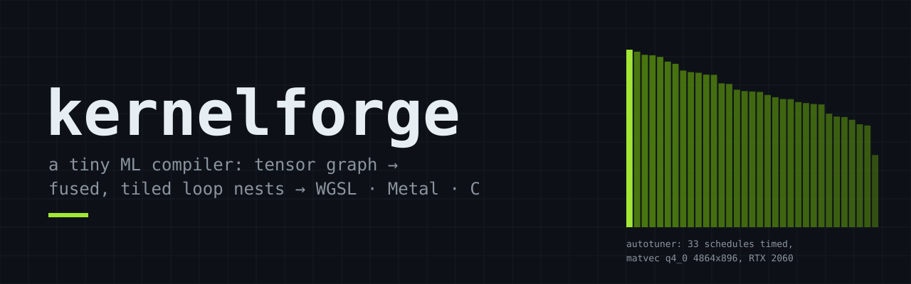
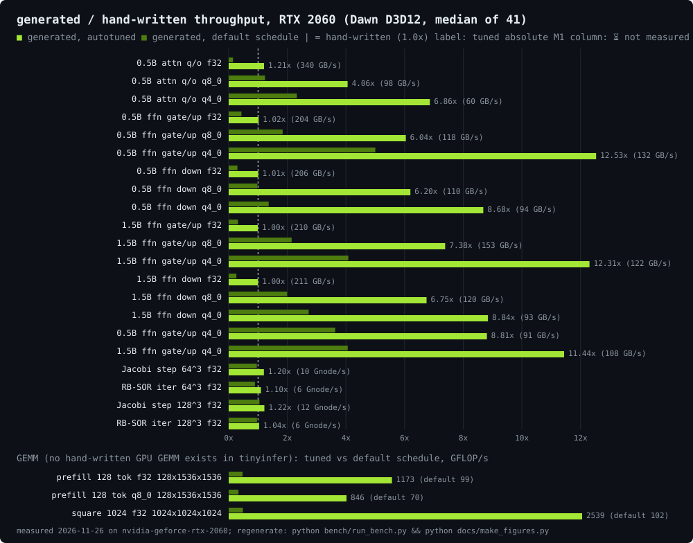
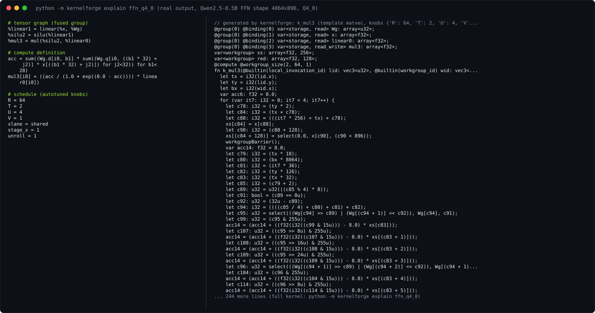
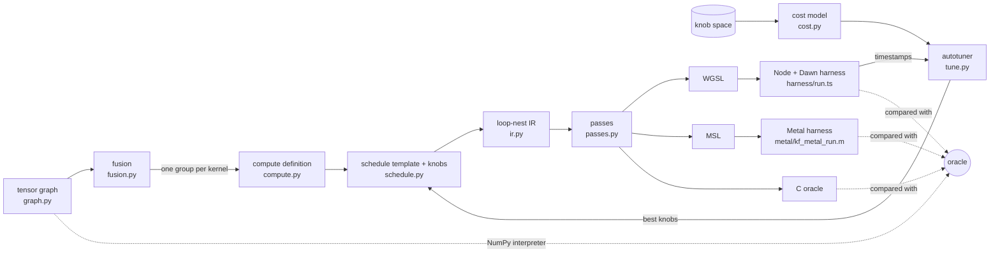

<p align="center">
  
</p>

<p align="center">
  <a href="https://github.com/coopersimpson101-debug/kernelforge/actions/workflows/ci.yml"></a>
  <a href="https://github.com/coopersimpson101-debug/kernelforge/releases/latest"></a>
  <a href="LICENSE"></a>
  
  
  
</p>

**A small Triton/TVM you can read in an evening.** kernelforge takes a tensor graph, fuses it,
lowers each fused group through a TVM-style compute/schedule split into tiled loop nests, and
writes WGSL, Metal and C kernels. Then it races them, on a real GPU, against the hand-written
kernels of two earlier projects: tinyinfer's quantised matvecs and flipgpu's pressure solver.

<p align="center">
  <a href="#quickstart">Quickstart</a> ·
  <a href="#how-it-works">How it works</a> ·
  <a href="#results">Results</a> ·
  <a href="#hardware-validation--todo-for-the-author">Hardware TODO</a> ·
  <a href="#roadmap">Roadmap</a>
</p>

<p align="center">
  
</p>
<p align="center">
  
</p>
<p align="center"><sub>Top: measured on an RTX 2060 (numbers in <a href="#results">Results</a>). Bottom: real compiler output for
tinyinfer's FFN gate (Q4_0, 4864x896): the fused graph group and compute definition on the left, the generated
WGSL on the right. Regenerate both with <code>python docs/make_figures.py</code>.</sub></p>

## Highlights

<!-- highlights:start -->
- **The whole stack is hand-written** (~4.3k lines of Python + a 190-line TypeScript WebGPU harness + a 130-line Objective-C Metal harness): graph IR, fusion, compute/schedule, bound inference, 8 loop-nest passes, 3 backends, cost model, tuner. NumPy is used only as the oracle.
- **Generated = hand-written at the same schedule, faster after tuning.** With tinyinfer's own layout (32 lanes per row) the generated Q4_0 / Q8_0 matvecs run within 2 % of the hand port; the tuner then finds 2-4 lanes per row and gets **4.1-7.4x** on Q8_0, **6.9-12.5x** on Q4_0 and **1.00-1.21x** on f32 across Qwen2.5-0.5B/1.5B shapes (RTX 2060, table below).
- **Fusion that matters:** tinyinfer's SwiGLU (`silu(Wg x) * (Wu x)`, 3 dispatches) becomes 2 kernels with the activation as a matvec epilogue: **8.8x / 11.4x** faster end to end for Q4_0 at 0.5B / 1.5B shapes.
- **flipgpu's pressure solver, regenerated from a 3-line graph:** Jacobi output **bit-identical** to flipgpu's own WGSL (byte-for-byte test, 3 schedules) and, after exhaustive schedule search, **1.20-1.22x** faster Jacobi steps and **1.04-1.10x** faster red-black SOR iterations.
- **GEMM from the same machinery:** shared + register tiling found by the tuner reaches **2.54 TFLOP/s** on a 1024³ f32 GEMM (39 % of the card's 6.45 TFLOP/s peak), 25x over the untuned schedule.
- **Checked, not trusted:** every generated kernel is compared with NumPy on random inputs: 17 zoo programs x (C oracle, default WGSL, 3 random schedules from each knob space, WebGPU-portable limits), plus the hand-written baselines; the tuner also rejects any candidate whose output is wrong (none were, over 1,186 timed schedules).
<!-- highlights:end -->

## Status

| | what | where it was checked |
|---|---|---|
| ✅ | Full test-suite: **105 passed**, 34 skipped (macOS-only Metal tests), `python -m pytest -q` | Windows 10 + RTX 2060 here |
| ✅ | Graph IR, fusion, compute/schedule, all passes; every zoo program vs NumPy through the **C oracle** | here (zig cc); Linux CI (gcc) |
| ✅ | Every zoo program as **WGSL on the RTX 2060**: default schedule, 3 random tuned schedules each, WebGPU-portable limits | here, Dawn D3D12 |
| ✅ | Hand-written baselines (tinyinfer port, flipgpu extract) vs NumPy; generated Jacobi == flipgpu byte for byte | here, RTX 2060 |
| ✅ | Benchmarks + autotuning on the RTX 2060 (table below) | here, see machine notes |
| ✅ | Generated **MSL** type-checks as C++ against a Metal shim | here (zig c++); Linux CI (clang++) |
| ⏳ | Generated MSL compiles with Apple's `xcrun metal` | CI job `macos` on macos-latest (written, not yet observed: needs the first push) |
| ⏳ | Generated MSL runs on a Metal GPU vs NumPy | CI `macos` (hosted runners may not expose a GPU; step is allowed to fail) |
| ⏳ | Any number on an **Apple M1** | needs the owner's Mac: `bench/run_bench_metal.py` |

## Quickstart

```bash
git clone https://github.com/coopersimpson101-debug/kernelforge && cd kernelforge
pip install -e .[dev] && npm install           # numpy/pytest/ziglang; Dawn WebGPU for Node (>= 22.18)
python -m kernelforge explain ffn_q4_0          # graph -> groups -> compute -> loop nest -> WGSL
python -m pytest -q                             # C oracle + WebGPU (skips with a reason if no GPU)
python bench/run_bench.py --quick               # generated vs hand-written on your GPU
```

## How it works



**Why compute/schedule (TVM) and not block programs (Triton).** Triton asks the *user* to write a
tiled block program; the compiler then handles the per-thread details. TVM asks for the maths only
(`out[i] = sum_k W[i,k]·x[k]`) and keeps every implementation decision in a separate, searchable
schedule. kernelforge's input is a graph (nobody writes kernels), the targets have very different
memory models (WGSL has no 8-bit loads, Metal has native ones), and the point of the exercise is to
let a tuner rediscover hand-written kernels, so the TVM split fits: one compute definition, many
schedules, a cost model and measurements choosing between them.

### 1. Tensor graph and fusion

`graph.py` is a DAG of ops with static shapes and storage dtypes (`f32`, `f16`, `u32`, and
tinyinfer's `q8_0` / `q4_0` blocks: 32 weights + one fp16 scale, 34 / 18 bytes, byte-compatible with
ggml). It has its own NumPy interpreter that never looks at the compiler, which makes it the oracle.

`fusion.py` partitions the graph in topological order with TVM-like pattern rules: an injective
producer with a single consumer is inlined (recomputed per element); an elementwise consumer that
reads a matmul or stencil result at the same index becomes its **epilogue**; ops whose leading
shape equals a reduction's rows join that **row group** (so RMSNorm is one kernel, and softmax, with
two reductions, is also one). A node needed outside its group is forced to materialise and the
partition is recomputed, so every group has exactly one output.

### 2. Compute definitions

`compute.py` turns a group into index expressions over `Read`s of the group's inputs; fusion is just
substitution. Two choices matter for the comparison:

* **Quantised matvec is block-factored**, as tinyinfer and ggml do:
  `y[n] = Σ_b d[n,b] · Σ_{j<32} q[n,32b+j] · x[32b+j]`, i.e. one fp16 scale multiply per block.
  (GEMM uses the flat form and dequantises while staging tiles into shared memory.)
* **The pressure stencil reproduces flipgpu's maths exactly**, including its padded
  `(nz+1)(ny+1)(nx+1)` lattice, the "outside the cells = SOLID" rule and the neighbour visiting order
  `x-, x+, y-, y+, z-, z+`, so the generated Jacobi step is bit-for-bit the same arithmetic.

### 3. Schedules, bound inference and staging

A schedule template per pattern (`injective`, `row`, `matvec`, `matmul`, `stencil`) maps loops to
workgroups/threads and splits the reduction; its knobs (tile sizes, rows per workgroup, lanes per
row, unroll factor, vector width, subgroup vs shared-memory reduction, which operands to stage…)
form the search space. The generic primitive underneath is `stage()` (TVM's `cache_read`): to stage
every read of a tensor `T` inside a loop region into a shared or register tile, it writes each index
as an affine form `Σ cᵥ·v + c₀` and **relaxes** the variables that vary inside the region (inner
loops and, for a shared tile, the cooperating thread indices) over `[0, extent)`:

$$\text{origin}_d = \sum_{v\ \text{fixed}} c_v v + c_0 + \sum_{v\ \text{relaxed},\,c_v<0} c_v(e_v-1),\qquad
\text{extent}_d = 1+\sum_{v\ \text{relaxed}} |c_v|\,(e_v-1)$$

Taking the union over all read sites gives the tile; reads are rewritten to tile coordinates and a
cooperative load loop (vectorisable along the last dimension, optional +1 padding against bank
conflicts) plus barriers is emitted. The same function produces the GEMM's `BM×BK` / `BN×BK` shared
tiles, its `TM`/`TN` register tiles (staging a shared tile into registers), the matvec's shared `x`
chunk and the stencil's `(wx+2)(wy+2)(wz+2)` halo tile; `tests/test_passes.py` checks these sizes.

### 4. Passes on the loop nest

| pass | what it does |
|---|---|
| `lower_reads` | n-d reads → flat loads; f16/Q8_0/Q4_0 expanded to byte/half loads; a bounds check (clamped index + select) only where interval analysis cannot prove the access in range. `if` conditions and `select` guards narrow the ranges (with relational facts on affine sums), which removes every check in the tuned kernels with divisible shapes |
| `simplify` | affine canonicalisation and range-aware `/`, `%` peeling: `(c·X + R)/c = X + R/c` when `0 ≤ R`, and `(g·X + v) % c = (g·X) % c + v` when `g | c`, `0 ≤ v < g` (this is what lets vector lanes stay contiguous) |
| `unroll` | `For(kind=unroll)` → straight-line copies, locals renamed |
| `vectorize` | `For(kind=vectorize)` → `vec4` loads/stores and `acc += dot(a, b)`; buffers whose every access is an aligned `vec4` are declared `array<vec4<f32>>`; non-matching loops fall back to unrolling |
| `slp_loads` | groups unrolled scalar loads `x[4k+0..3]` into one aligned `vec4` load |
| `combine_bytes` | byte loads at `base+c, base+c+1, …` → one 32-bit (possibly unaligned) word load |
| `expand_words` | WGSL only (no 8-bit storage type): words, bytes and halves → `array<u32>` loads + shifts; consecutive words share loads |
| `cse` | hoists repeated pure sub-expressions; never moves a load out of a `select` arm |

C and MSL lower `select` to a lazy `?:`, so a guarded access is never executed out of range; WGSL's
`select` is eager, which is safe because WebGPU guarantees robust (clamped) buffer accesses.

### 5. Cost model and autotuner

`cost.py` predicts `max(DRAM time, FMA time, shared-memory time)` divided by a parallel efficiency
(Little's law: bytes in flight vs bandwidth × latency; 32-byte sector coalescing; wave
quantisation), plus launch, barrier and reduction-tree costs, from vendor numbers in `target.py`.
`tune.py` ranks the whole knob space with it, compiles the top 16 (24 for GEMM) plus the default
schedule, and times them all in **one** harness process on the same buffers; each candidate's
output is also checked against NumPy and rejected if wrong. How well the model ranks schedules is
measured, not assumed (table in Results).

### 6. Execution and timing

`harness/run.ts` (TypeScript run directly by Node's type stripping) opens a Dawn device through the
[`webgpu`](https://www.npmjs.com/package/webgpu) npm package, as splatweb's tests do, requesting
`timestamp-query`, `subgroups` and the adapter's real limits. A timed run is one compute pass of R
back-to-back repetitions bracketed by timestamp queries (Dawn's timestamp quantisation disabled);
the reported value is the median over 21 runs of pass-time / R. The Metal harness
(`metal/kf_metal_run.m`) reads the same job format and times command buffers with
`GPUStartTime/GPUEndTime`.

**Baselines.** tinyinfer's GPU kernels exist only in Metal, so `bench/handwritten/tinyinfer_*.wgsl`
are line-by-line WGSL ports (one 32-lane SIMD-group per row, 8 rows per workgroup, `simd_sum` →
`subgroupAdd`, a uniform `MatvecArgs`); the one forced deviation is reading the 34/18-byte blocks
through `array<u32>`. The original Metal file is kept verbatim for the M1 run. flipgpu's kernels
are extracted byte-for-byte from its `flip.wgsl` by `scripts/extract_flipgpu.py` and run with its
own `Params` uniform layout and 1-D 64-thread dispatch.

## Results

**Generated vs hand-written, RTX 2060** (`python bench/run_bench.py`; raw data in
[`bench/results/rtx2060.json`](bench/results/rtx2060.json)). GB/s counts compulsory bytes (weights +
x + y); Gnode/s counts lattice nodes updated per second (a Jacobi step, or a full red + black SOR
iteration).

<!-- results:start -->
| family | case | dtype | metric | hand-written | generated (default) | generated (tuned) | tuned / hand | M1 (tuned / hand) |
|---|---|---|---|---:|---:|---:|---:|:---:|
| matvec | 0.5B attn q/o `896x896` | f32 | GB/s | 282.3 | 41.5 | 340.4 | **1.21x** | ⏳ |
| matvec | 0.5B attn q/o `896x896` | q8_0 | GB/s | 24.2 | 29.9 | 98.0 | **4.06x** | ⏳ |
| matvec | 0.5B attn q/o `896x896` | q4_0 | GB/s | 8.7 | 20.3 | 59.8 | **6.86x** | ⏳ |
| matvec | 0.5B ffn gate/up `4864x896` | f32 | GB/s | 200.3 | 87.3 | 204.3 | **1.02x** | ⏳ |
| matvec | 0.5B ffn gate/up `4864x896` | q8_0 | GB/s | 19.5 | 35.8 | 117.5 | **6.04x** | ⏳ |
| matvec | 0.5B ffn gate/up `4864x896` | q4_0 | GB/s | 10.6 | 52.8 | 132.4 | **12.53x** | ⏳ |
| matvec | 0.5B ffn down `896x4864` | f32 | GB/s | 204.7 | 61.0 | 206.3 | **1.01x** | ⏳ |
| matvec | 0.5B ffn down `896x4864` | q8_0 | GB/s | 17.7 | 17.3 | 109.7 | **6.20x** | ⏳ |
| matvec | 0.5B ffn down `896x4864` | q4_0 | GB/s | 10.8 | 14.8 | 93.9 | **8.68x** | ⏳ |
| matvec | 1.5B ffn gate/up `8960x1536` | f32 | GB/s | 210.7 | 66.7 | 209.7 | **1.00x** | ⏳ |
| matvec | 1.5B ffn gate/up `8960x1536` | q8_0 | GB/s | 20.8 | 44.6 | 153.4 | **7.38x** | ⏳ |
| matvec | 1.5B ffn gate/up `8960x1536` | q4_0 | GB/s | 9.9 | 40.6 | 122.4 | **12.31x** | ⏳ |
| matvec | 1.5B ffn down `1536x8960` | f32 | GB/s | 211.2 | 55.2 | 211.0 | **1.00x** | ⏳ |
| matvec | 1.5B ffn down `1536x8960` | q8_0 | GB/s | 17.8 | 35.5 | 120.3 | **6.75x** | ⏳ |
| matvec | 1.5B ffn down `1536x8960` | q4_0 | GB/s | 10.6 | 28.8 | 93.3 | **8.84x** | ⏳ |
| ffn | 0.5B ffn gate/up `4864x896` | q4_0 | GB/s | 10.3 | 37.3 | 90.5 | **8.81x** | ⏳ |
| ffn | 1.5B ffn gate/up `8960x1536` | q4_0 | GB/s | 9.5 | 38.4 | 108.2 | **11.44x** | ⏳ |
| gemm | prefill 128 tok `128x1536x1536` | f32 | GFLOP/s | n/a | 99.5 | 1173.1 | 11.79x vs default | ⏳ |
| gemm | prefill 128 tok `128x1536x1536` | q8_0 | GFLOP/s | n/a | 70.0 | 846.2 | 12.09x vs default | ⏳ |
| gemm | square 1024 `1024x1024x1024` | f32 | GFLOP/s | n/a | 101.9 | 2539.3 | 24.92x vs default | ⏳ |
| pressure | Jacobi step 64^3 `64x64x64` | f32 | Gnode/s | 8.1 | 7.8 | 9.7 | **1.20x** | ⏳ |
| pressure | RB-SOR iter 64^3 `64x64x64` | f32 | Gnode/s | 5.2 | 4.7 | 5.8 | **1.10x** | ⏳ |
| pressure | Jacobi step 128^3 `128x128x128` | f32 | Gnode/s | 10.2 | 10.7 | 12.4 | **1.22x** | ⏳ |
| pressure | RB-SOR iter 128^3 `128x128x128` | f32 | Gnode/s | 5.4 | 5.2 | 5.6 | **1.04x** | ⏳ |

Measured 2026-11-26 on nvidia-geforce-rtx-2060 (D3D12 driver version 32.0.15.6094), Windows 10, Ryzen 5 3600 host; Dawn via the `webgpu` npm package 0.6.2 (D3D12 backend); WebGPU timestamp-query (per compute pass, divided by repeat count); median of 41 runs. Every output was checked against NumPy in the same run (worst max-relative error 3.0e-06).
<!-- results:end -->

**Autotuning** (`bench/results/rtx2060_tuning.json` has every candidate's predicted and measured time):

<!-- tuning:start -->
| kernel | template | space | timed | tuning wall time | default | tuned | best knobs |
|---|---|---:|---:|---:|---:|---:|---|
| matvec f32 896x896 | matvec | 294 | 33 | 10 s | 55.3 us | 13.9 us | `{"R":2,"T":32,"U":2,"V":1,"xlane":"subgroup","stage_x":0,"unroll":1}` |
| matvec q8_0 896x896 | matvec | 147 | 33 | 76 s | 32.8 us | 10.4 us | `{"R":16,"T":4,"U":2,"V":1,"xlane":"shared","stage_x":1,"unroll":1}` |
| matvec q4_0 896x896 | matvec | 147 | 33 | 44 s | 25.4 us | 9.2 us | `{"R":16,"T":4,"U":2,"V":1,"xlane":"shared","stage_x":1,"unroll":1}` |
| matvec f32 4864x896 | matvec | 294 | 33 | 20 s | 200.6 us | 85.0 us | `{"R":1,"T":128,"U":2,"V":1,"xlane":"shared","stage_x":0,"unroll":1}` |
| matvec q8_0 4864x896 | matvec | 147 | 33 | 31 s | 153.8 us | 47.8 us | `{"R":32,"T":2,"U":2,"V":1,"xlane":"shared","stage_x":1,"unroll":1}` |
| matvec q4_0 4864x896 | matvec | 147 | 33 | 40 s | 48.8 us | 19.8 us | `{"R":32,"T":2,"U":2,"V":1,"xlane":"shared","stage_x":1,"unroll":1}` |
| matvec f32 896x4864 | matvec | 294 | 33 | 16 s | 286.6 us | 84.6 us | `{"R":4,"T":32,"U":4,"V":1,"xlane":"subgroup","stage_x":0,"unroll":1}` |
| matvec q8_0 896x4864 | matvec | 147 | 33 | 55 s | 187.8 us | 43.2 us | `{"R":16,"T":4,"U":2,"V":1,"xlane":"shared","stage_x":1,"unroll":1}` |
| matvec q4_0 896x4864 | matvec | 147 | 33 | 60 s | 122.2 us | 29.5 us | `{"R":32,"T":2,"U":4,"V":1,"xlane":"shared","stage_x":1,"unroll":1}` |
| matvec f32 8960x1536 | matvec | 294 | 33 | 8 s | 742.5 us | 257.5 us | `{"R":1,"T":64,"U":2,"V":1,"xlane":"shared","stage_x":0,"unroll":1}` |
| matvec q8_0 8960x1536 | matvec | 147 | 33 | 37 s | 327.6 us | 95.6 us | `{"R":32,"T":2,"U":4,"V":1,"xlane":"shared","stage_x":1,"unroll":1}` |
| matvec q4_0 8960x1536 | matvec | 147 | 33 | 57 s | 192.2 us | 64.0 us | `{"R":32,"T":2,"U":2,"V":1,"xlane":"shared","stage_x":1,"unroll":1}` |
| matvec f32 1536x8960 | matvec | 294 | 33 | 8 s | 910.0 us | 257.4 us | `{"R":2,"T":32,"U":4,"V":1,"xlane":"subgroup","stage_x":0,"unroll":1}` |
| matvec q8_0 1536x8960 | matvec | 147 | 33 | 51 s | 574.5 us | 120.8 us | `{"R":32,"T":2,"U":4,"V":1,"xlane":"shared","stage_x":1,"unroll":1}` |
| matvec q4_0 1536x8960 | matvec | 147 | 33 | 59 s | 270.7 us | 83.8 us | `{"R":32,"T":2,"U":4,"V":1,"xlane":"shared","stage_x":1,"unroll":1}` |
| ffn-up q4_0 4864x896 | matvec | 147 | 17 | 24 s | 47.7 us | 19.1 us | `{"R":64,"T":2,"U":4,"V":1,"xlane":"shared","stage_x":1,"unroll":1}` |
| ffn-gate+silu*mul q4_0 4864x896 | matvec | 147 | 17 | 20 s | 74.6 us | 30.5 us | `{"R":64,"T":2,"U":4,"V":1,"xlane":"shared","stage_x":1,"unroll":1}` |
| ffn-up q4_0 8960x1536 | matvec | 147 | 17 | 16 s | 193.3 us | 68.9 us | `{"R":64,"T":1,"U":4,"V":1,"xlane":"shared","stage_x":1,"unroll":1}` |
| ffn-gate+silu*mul q4_0 8960x1536 | matvec | 147 | 17 | 33 s | 199.3 us | 70.3 us | `{"R":64,"T":1,"U":4,"V":1,"xlane":"shared","stage_x":1,"unroll":1}` |
| gemm f32 128x1536x1536 | matmul | 1076 | 25 | 252 s | 6065.5 us | 514.8 us | `{"BM":32,"BN":128,"BK":16,"TM":8,"TN":8,"stage":1,"vec":1,"reg":1,"pad":1,"unroll":1}` |
| gemm q8_0 128x1536x1536 | matmul | 1076 | 25 | 308 s | 6271.7 us | 567.7 us | `{"BM":32,"BN":128,"BK":16,"TM":8,"TN":8,"stage":1,"vec":1,"reg":1,"pad":1,"unroll":1}` |
| gemm f32 1024x1024x1024 | matmul | 1076 | 25 | 245 s | 21089.2 us | 820.9 us | `{"BM":64,"BN":64,"BK":16,"TM":8,"TN":8,"stage":1,"vec":1,"reg":1,"pad":1,"unroll":1}` |
| jacobi 64^3 | stencil | 136 | 137 | 126 s | 36.4 us | 29.2 us | `{"wx":32,"wy":4,"wz":1,"cz":2,"stage":0}` |
| rbsor-red 64^3 | stencil | 136 | 137 | 113 s | 33.9 us | 28.0 us | `{"wx":32,"wy":4,"wz":1,"cz":2,"stage":0}` |
| jacobi 128^3 | stencil | 136 | 137 | 116 s | 180.2 us | 169.3 us | `{"wx":32,"wy":4,"wz":1,"cz":2,"stage":0}` |
| rbsor-red 128^3 | stencil | 136 | 137 | 202 s | 230.3 us | 175.2 us | `{"wx":64,"wy":1,"wz":1,"cz":2,"stage":0}` |
<!-- tuning:end -->

**Cost-model quality** (`python bench/costmodel_sweep.py`: every schedule in the space timed):

<!-- costmodel:start -->
| kernel | schedules timed | Spearman(pred, meas) | model rank of true best | top-16 pick vs true best |
|---|---:|---:|---:|---:|
| matvec q4_0 4864x896 | 143 | 0.91 | 19 | 1.01x |
| matvec f32 4864x896 | 294 | 0.70 | 47 | 1.01x |
| jacobi 64^3 | 136 | -0.46 | 90 | 1.71x |
<!-- costmodel:end -->

<!-- discussion:start -->
**Reading the numbers honestly.**

* The quantised "hand-written" column is a *WGSL port* of kernels tinyinfer wrote for Apple GPUs.
  The lanes-per-row sweep below (generated kernel, rows per workgroup = 256 / T, everything else
  fixed; microseconds, 4864x896) shows that at T = 32, tinyinfer's layout, the generated code is as
  fast as the port (235 vs 239 µs for Q4_0, 201 vs 202 µs for Q8_0). The 4-12x is the *schedule*
  the tuner found for this GPU, not better instruction selection, and a hand-written kernel with
  2-4 lanes per row would match it. The reason one 32-lane SIMD group per 28-48-block row is slow
  here was not profiled; plausibly too little work per lane for the reduction it pays.
* f32 matvecs are bandwidth bound (~205-211 GB/s of the card's 336 GB/s); generated and hand
  ports both sit there. The 896x896 case fits in L2, hence > 300 GB/s.
* Pressure solve: the untuned schedule (1-D, 64 threads, like flipgpu) is 0.90-1.05x of flipgpu;
  the tuned ones use 32x4x1 blocks (64x1x1 for RB-SOR at 128³) with two z-planes per thread
  (`cz = 2`) and no shared-memory staging: every staged variant measured slower, presumably
  because the L1 cache already captures the 7-point reuse (not profiled). The
  generated kernel also specialises the grid size and SOR ω as constants, where flipgpu reads them
  from a uniform; that is a legitimate compiler advantage but part of the gap.
* No hand-written GEMM exists in either project, so GEMM is reported tuned vs default only.
* **Shared GPU.** These runs were made on a desktop that other jobs were using: `nvidia-smi` showed
  88-100 % utilisation from other processes before most matvec/FFN/GEMM jobs (0 % before the
  pressure jobs; samples in the JSON). To keep the comparison fair, hand-written, default and tuned
  kernels run in the same process, interleaved round-robin, with short timed passes; the absolute
  numbers are still probably pessimistic.

**Lanes per row** (`python bench/lanes_ablation.py`, µs, lower is better):

<!-- lanes:start -->
| dtype | tinyinfer port (T = 32) | T = 1 | T = 2 | T = 4 | T = 8 | T = 16 | T = 32 | T = 64 | T = 128 | T = 256 |
|---|---:|---:|---:|---:|---:|---:|---:|---:|---:|---:|
| q4_0 | 239 | 43 | **37** | 45 | 71 | 123 | 235 | 240 | 258 | 298 |
| q8_0 | 202 | 55 | **46** | 46 | 64 | 108 | 201 | 205 | 220 | 254 |
| f32 | 87 | 394 | 170 | 99 | 88 | 87 | 86 | **85** | 85 | 116 |
<!-- lanes:end -->

**What the cost model gets right and wrong.** For matvecs it ranks schedules well (Spearman 0.91
for Q4_0) and the top-16 pick is within 1 % of the exhaustive optimum, but only after one fitted
constant (per-lane cost of the dequantising loop, marked in `cost.py`). For the stencil it is
*anti*-correlated with reality (-0.46): it believes shared-memory halo staging pays, and measurement
says it does not. That is why the stencil benchmark tunes exhaustively (136 schedules).
<!-- discussion:end -->

## Hardware validation / TODO for the author

**Apple M1 (Metal).** Nothing has been measured on Apple hardware. On the M1:

```bash
pip install -e .[dev]
mkdir -p build && clang -fobjc-arc -O2 -framework Metal -framework Foundation metal/kf_metal_run.m -o build/kf_metal_run
python -m pytest -q tests/test_msl.py                # xcrun metal compile + GPU run vs NumPy
python bench/run_bench_metal.py                      # tinyinfer's original Metal kernels vs generated MSL (tuned on the Mac)
```

| case | dtype | tinyinfer Metal (GB/s) | generated default | generated tuned | tuned / hand |
|---|---|---:|---:|---:|---:|
| 0.5B ffn gate/up 4864x896 | f32 / q8_0 / q4_0 | ⏳ | ⏳ | ⏳ | ⏳ |
| 1.5B ffn gate/up 8960x1536 | f32 / q8_0 / q4_0 | ⏳ | ⏳ | ⏳ | ⏳ |
| 1.5B ffn down 1536x8960 | f32 / q8_0 / q4_0 | ⏳ | ⏳ | ⏳ | ⏳ |
| flipgpu Jacobi / RB-SOR (WebGPU in Safari/Chrome on the Mac) | f32 | ⏳ | ⏳ | ⏳ | ⏳ |

**RTX 2060, quiet machine.** The numbers above were taken while other jobs were using the same GPU
(see the note under the table). For publication-quality numbers re-run on an idle GPU:
`python bench/run_bench.py && python bench/costmodel_sweep.py && python docs/make_figures.py`.

**CI.** The `macos` job (Apple compiler + Metal run) has been written but has not run yet; check
its first result after the push.

## Roadmap

- [ ] Quantised GEMM with integer dot products (`dot4I8Packed` in WGSL, `char4` in MSL), as tinyinfer does on the CPU.
- [ ] Schedule search beyond grid search: evolutionary search seeded by the cost model, learned cost model from the logged measurements.
- [ ] Loop-invariant code motion and a register-pressure model (the row template recomputes a few scalars per element).
- [ ] Attention (online softmax) as a fused group; multi-output fusion.
- [ ] Tensor-core / simdgroup-matrix GEMM (`subgroupMatrix` once it lands in WebGPU, `simdgroup_matrix` in MSL).
- [ ] Emit a whole tinyinfer decoder step and run it end-to-end through the harness.

## License

MIT, see [LICENSE](LICENSE). Downloads used: the `webgpu` npm package (Dawn binaries, from npm),
`@resvg/resvg-js` (npm, PNG rendering only) and `ziglang` (PyPI, C compiler on Windows).
